# Superstore · Arquitectura Medallion en Azure Databricks

**Proyecto final · Ingeniería de Datos e IA con Databricks (Smart Data, Grupo 18)**
Autor: **Renzo Valencia Castillo** · Lima, Perú · Noviembre 2026

ETL en **PySpark** sobre **Azure Databricks + Unity Catalog** con arquitectura **Medallion** (Raw → Bronze → Silver → Golden). La conexión al Data Lake se hace con **Managed Identity**. El ETL se despliega de **desarrollo a producción con CI/CD en GitHub Actions** y sus datos se consumen desde un **AI/BI Dashboard, Genie, Azure SQL + Power BI y Delta Sharing**.

---

## 1. Resumen ejecutivo

> **Mensaje clave.** El negocio crece (+29.5 % en 2020 y +20.4 % en 2021), pero **los descuentos mayores al 20 % destruyen US$135 mil de utilidad**. Esa pérdida equivale al 47 % de la utilidad total del período. Un pipeline reproducible y gobernado convierte 9,994 líneas de venta en 4 marts que hacen visible esa fuga de margen, y se despliega a producción sin intervención manual.

| | |
|---|---|
| **Situación** | Superstore vende en 4 regiones de EE. UU. y 3 categorías. Los datos llegan como archivos sueltos (CSV de órdenes, JSON de devoluciones, Parquet de gerentes) sin control de calidad ni historial. |
| **Complicación** | El área financiera no puede responder con confianza qué productos y descuentos destruyen margen, ni quién debe ver qué datos. Cada análisis se rehace a mano. |
| **Resolución** | Arquitectura medallion en Unity Catalog con reglas de calidad, auditoría por ejecución, permisos por rol y un workflow productivo que despliega y ejecuta GitHub Actions. Las tablas Golden alimentan dashboards, lenguaje natural (Genie), Power BI y un socio externo vía Delta Sharing. |

**KPIs del pipeline** *(última ejecución en producción)*

| Ventas 2018–2021 | Utilidad | Margen | Órdenes | Tasa de devolución | Filas Bronze → Silver | Rechazadas por calidad |
|:---:|:---:|:---:|:---:|:---:|:---:|:---:|
| **US$2.30 M** | **US$286.4 mil** | **12.5 %** | **5,009** | **5.9 %** | **9,994 → 9,994** | **0** |

**Hallazgos que habilitan los marts Golden**

| # | Hallazgo | Evidencia (golden) |
|---|---|---|
| 1 | Los descuentos de 21–40 % pierden US$35.8 mil y los mayores al 40 % pierden US$99.6 mil. Las ventas sin descuento generan US$321 mil de utilidad. | `silver.ventas_detalle.banda_descuento` |
| 2 | Tres subcategorías son deficitarias: **Tables** (−US$17.7 mil), **Bookcases** (−US$3.5 mil) y **Supplies** (−US$1.2 mil). | `golden.rentabilidad_subcategoria` |
| 3 | **Central** tiene el menor margen (7.9 %), frente al 14.9 % de **West**. | `golden.kpi_mensual` |
| 4 | Las ventas crecen 20 % en 2021, pero el margen cae de 13.4 % a 12.7 %. | `golden.kpi_mensual` (YoY) |
| 5 | 395 de 793 clientes (50 %) explican el 80 % de las ventas (clase A). | `golden.clientes_pareto` |

---

## 2. Arquitectura

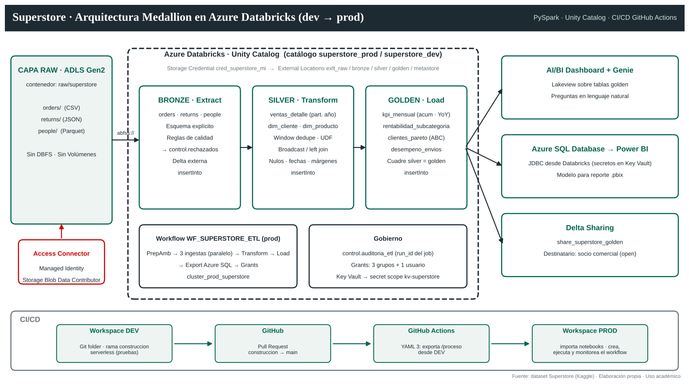

**Flujo:**
1. Los insumos se alojan en el contenedor **`raw`** de ADLS Gen2. No se usan DBFS ni Volúmenes.
2. Databricks accede al lake con la **Managed Identity** de un *Access Connector* (Storage Credential `cred_superstore_mi` → External Locations).
3. El workflow **`WF_SUPERSTORE_ETL`** ejecuta: `Preparación de Ambiente → 3 ingestas en paralelo → Transform → Load → Export Azure SQL → Grants`.
4. Las tablas Golden se consumen en **AI/BI Dashboard + Genie**, **Power BI** (vía Azure SQL) y **Delta Sharing**.
5. Todo cambio pasa por **GitHub** (rama `construccion` → PR → `main`). **GitHub Actions** despliega `/proceso` a producción y ejecuta el workflow.

**Aislamiento dev / prod:** ambos workspaces comparten el metastore de East US 2 y el Data Lake. Cada ambiente escribe en su **propio catálogo** (`superstore_dev` / `superstore_prod`) y en su **propio prefijo físico** (`/dev/…`, `/prod/…`). Solo hay **un clúster encendido**, el de producción; en dev se usa serverless.

**Decisiones tomadas por restricciones del entorno (suscripción Free Trial):**

| Restricción encontrada | Decisión |
|---|---|
| Cuota de 4 vCPU por región | Clúster prod *single node* de 4 núcleos; desarrollo en cómputo **serverless** |
| `Standard_DS3_v2` sin capacidad en East US 2 (`CLOUD_PROVIDER_RESOURCE_STOCKOUT`) | Clúster prod en **`Standard_D4ds_v5`** (4 núcleos, 16 GB) |
| La suscripción no puede crear servidores SQL en East US 2 | **Azure SQL Database** en **Central US**, con la oferta gratuita (serverless con *auto-pause*) |
| El cómputo serverless no soporta *persist* ni la fuente JDBC | `persist` solo en prod; la exportación a Azure SQL corre solo en el workflow productivo. Si no existe el secret scope, la tarea termina en *SKIPPED* sin romper el flujo. |

---

## 3. Servicios utilizados

| # | Servicio | Rol en el proyecto |
|---|---|---|
| 1 | **Azure Data Lake Storage Gen2** | Capa raw y almacenamiento físico Delta de bronze/silver/golden |
| 2 | **Access Connector for Azure Databricks** | Managed Identity para acceder al lake (sin llaves ni secretos) |
| 3 | **Azure Databricks (2 workspaces)** | Desarrollo (`dbw-superstore-dev`) y producción (`dbw-superstore-prod`) |
| 4 | **Unity Catalog** | Storage credential, external locations, catálogos, esquemas, tablas, grants y linaje |
| 5 | **Databricks Workflows (Jobs)** | Orquestación del ETL en producción (DAG de 8 tareas) |
| 6 | **GitHub + GitHub Actions** | Repositorio, ramas y pipeline CI/CD dev → prod (YAML 3) |
| 7 | **Azure Key Vault** | Credenciales de Azure SQL vía secret scope `kv-superstore` |
| 8 | **Azure SQL Database** | Destino relacional de las tablas Golden para Power BI |
| 9 | **Databricks AI/BI Dashboard** | Dashboard sobre las tablas Golden |
| 10 | **Databricks Genie** | Consultas en lenguaje natural sobre Golden |
| 11 | **Power BI** | Reporte financiero (`dashboard/*.pbix`) |
| 12 | **Delta Sharing** | Publicación de KPIs a un socio externo (open sharing) |

---

## 4. Estructura del repositorio

```
superstore-databricks-medallion/
├── .github/workflows/      → deploy-databricks.yml  (CI/CD dev → prod, basado en YAML 3)
├── datasets/               → insumos del ETL (CSV, JSON, Parquet) + descripción de la fuente
├── PrepAmb/                → preparación de ambiente en SQL (external locations, catálogo, esquemas, tablas)
├── proceso/                → notebooks que se DESPLIEGAN y EJECUTAN en producción
│   ├── 1_Preparacion_Ambiente.py
│   ├── 2_Ingest_Orders.py · 2_Ingest_Returns.py · 2_Ingest_People.py
│   ├── 3_Transform.py
│   ├── 4_Load.py
│   ├── 5_Export_AzureSQL.py
│   └── 6_Grants.py
├── seguridad/              → grants a usuarios y grupos (.sql)
├── reversion/              → contingencia: drop de objetos lógicos, rutas físicas y workflow (.sql / .py)
├── delta-sharing/          → share + recipient sobre tablas Golden (.py)
├── dashboard/              → AI/BI dashboard (.lvdash.json + .png), Power BI (.pbix + .png)
├── certificaciones/        → credenciales Databricks Academy (.png + enlaces)
├── evidencias/             → capturas: servicios, ejecuciones del workflow y de GitHub Actions, arquitectura
└── README.md
```

---

## 5. Datasets (insumos)

Fuente: **Sample – Superstore** (dataset de muestra oficial de Tableau; las órdenes también están publicadas en Kaggle). Las tres entidades del Excel original se publican en la capa raw **en tres formatos distintos**. Detalle en [`datasets/README.md`](datasets/README.md).

| Insumo | Formato | Ruta raw | Filas | Descripción |
|---|---|---|---:|---|
| Órdenes | CSV | `raw/superstore/orders/` | 9,994 | Línea de venta 2018–2021: orden, cliente, producto, ventas, cantidad, descuento, utilidad |
| Devoluciones | JSON | `raw/superstore/returns/` | 800 (296 órdenes) | Órdenes devueltas (una fila por línea, con duplicados) |
| Gerentes regionales | Parquet | `raw/superstore/people/` | 4 | Gerente responsable por región |

---

## 6. Modelo de datos por capa

| Capa | Tabla | Descripción |
|---|---|---|
| Bronze | `bronze.orders` · `bronze.returns` · `bronze.people` | Datos tipados con trazabilidad (`source_file`, `ingestion_ts`) |
| Silver | `silver.ventas_detalle` | Línea de venta limpia y enriquecida, **particionada por año** |
| Silver | `silver.dim_cliente` · `silver.dim_producto` | Dimensiones conformadas |
| Golden | `golden.kpi_mensual` | Ventas, utilidad, margen, devoluciones, acumulado anual y crecimiento YoY |
| Golden | `golden.rentabilidad_subcategoria` | Ranking de utilidad por región y subcategorías deficitarias |
| Golden | `golden.clientes_pareto` | Participación acumulada y clasificación ABC de clientes |
| Golden | `golden.desempeno_envios` | Días de despacho (promedio y p90) y margen por modo de envío |
| Control | `control.auditoria_etl` · `control.rechazados` | Bitácora por `run_id` del job y registros que no pasan las reglas de calidad |

Todas las tablas se crean en **Preparación de Ambiente**. El ETL **solo escribe con `insertInto`**.

---

## 7. ETL en PySpark: técnicas aplicadas

| Técnica (vista en el curso) | Dónde |
|---|---|
| Esquemas explícitos `StructType` / `StructField` (CSV y JSON), lectura de Parquet | `2_Ingest_*` |
| Opciones de lectura (`header`, `quote`, `escape`, `multiLine`, `mode=PERMISSIVE`) | `2_Ingest_Orders`, `2_Ingest_Returns` |
| Columna oculta `_metadata.file_path` (trazabilidad) | `2_Ingest_*` |
| `select` / `alias` / `withColumnRenamed`, `trim`, `initcap`, `lower` | `2_Ingest_*`, `3_Transform` |
| Parseo de fechas multi-formato tolerante a ANSI (`try_to_timestamp`) | `2_Ingest_Orders` |
| Reglas de calidad declarativas + cuarentena | `2_Ingest_*` → `control.rechazados` |
| Deduplicación con `Window` + `row_number` | `3_Transform` |
| Manejo de nulos: `fillna`, `coalesce`, `dropDuplicates` | `3_Transform`, `2_Ingest_People` |
| **UDF de Python** (y su equivalente nativo `when/otherwise`) | `3_Transform` |
| **Broadcast join** y **left join** | `3_Transform` |
| `cache` / `persist` / `unpersist` | `3_Transform` |
| `repartition` por columna de partición + tabla particionada | `3_Transform` |
| Agregaciones `groupBy/agg`, `countDistinct`, `percentile_approx` | `4_Load` |
| Ventanas analíticas: suma acumulada, `lag` (YoY), `dense_rank`, `row_number` | `3_Transform`, `4_Load` |
| Escritura con `insertInto` (overwrite / append) | todos |
| Lectura y escritura JDBC (Azure SQL) | `5_Export_AzureSQL` |
| Parametrización con `dbutils.widgets` (`base_parameters` en el workflow) | todos |

---

## 8. Calidad de datos y auditoría

- **Reglas en Bronze** (orders): ids nulos, fechas inválidas, envío anterior a la orden, ventas/cantidad no positivas, descuento fuera de [0, 1], utilidad nula. Los registros inválidos se guardan en `control.rechazados` con el motivo.
- **Deduplicación en Silver** por `row_id`, quedándose con la versión más reciente.
- **Cuadre Silver = Golden:** si las ventas no cuadran, la tarea `Load` falla y el workflow se detiene.
- **Bitácora:** cada tabla cargada registra filas leídas, escritas y rechazadas en `control.auditoria_etl` con el `run_id` del job.

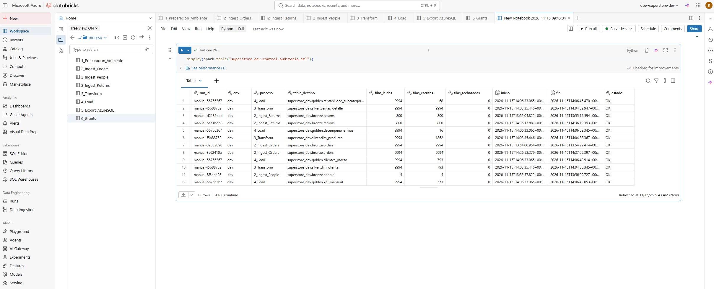

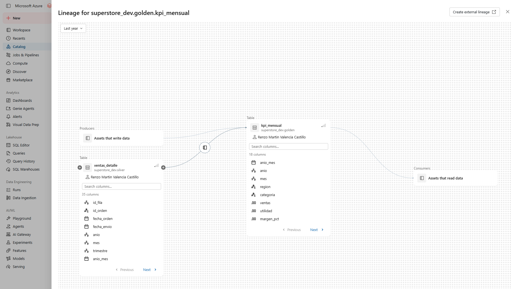

---

## 9. Seguridad (Unity Catalog)

| Principal | Tipo | Permisos |
|---|---|---|
| `grp_ingenieros_datos` | Grupo | `USE CATALOG`, `USE SCHEMA` + `SELECT` + `MODIFY` en todas las capas, `READ FILES` en `exlt_raw` |
| `grp_analistas_finanzas` | Grupo | `USE CATALOG`, `USE SCHEMA` + `SELECT` en silver y golden |
| `grp_consumidores_bi` | Grupo | `USE CATALOG`, `USE SCHEMA` golden, `SELECT` en 3 tablas golden |
| `auditor.superstore@example.com` | Usuario | `SELECT` en `control.auditoria_etl` |

Usuarios y grupos ficticios creados en la Account Console y asignados a ambos workspaces. Script: `seguridad/01_Grants_Usuarios_Grupos.sql`. Se aplican automáticamente en la última tarea del workflow (`proceso/6_Grants`).

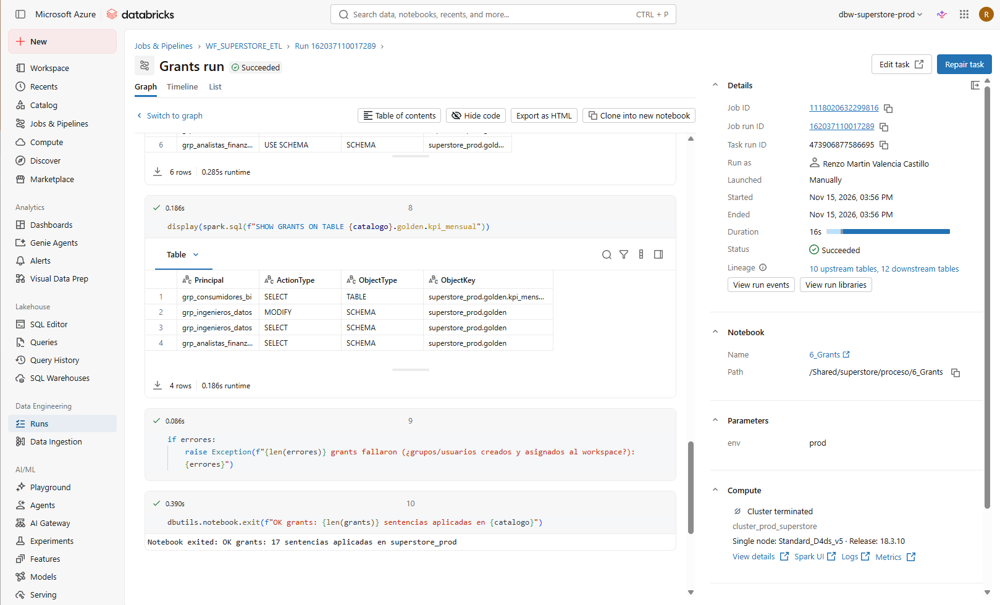

---

## 10. CI/CD (GitHub Actions)

1. Desarrollo en el **Git folder** del workspace dev, sobre la rama `construccion`.
2. *Commit & push* → **Pull Request** `construccion → main` → merge.
3. El merge dispara `.github/workflows/deploy-databricks.yml` (YAML 3 del curso), que:
   - exporta los notebooks de `/proceso` desde dev y **valida** cada exportación;
   - los importa en prod (`/Shared/superstore/proceso`);
   - elimina y vuelve a crear el workflow `WF_SUPERSTORE_ETL` sobre el clúster existente `cluster_prod_superstore`;
   - lo ejecuta con `env=prod` y lo monitorea hasta terminar.
4. Secrets del repositorio: `DATABRICKS_ORIGIN_HOST`, `DATABRICKS_ORIGIN_TOKEN`, `DATABRICKS_DEST_HOST`, `DATABRICKS_DEST_TOKEN`.

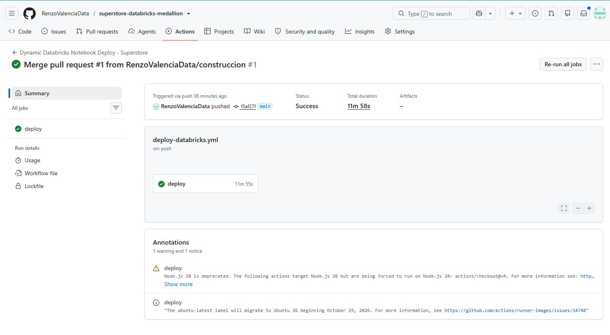

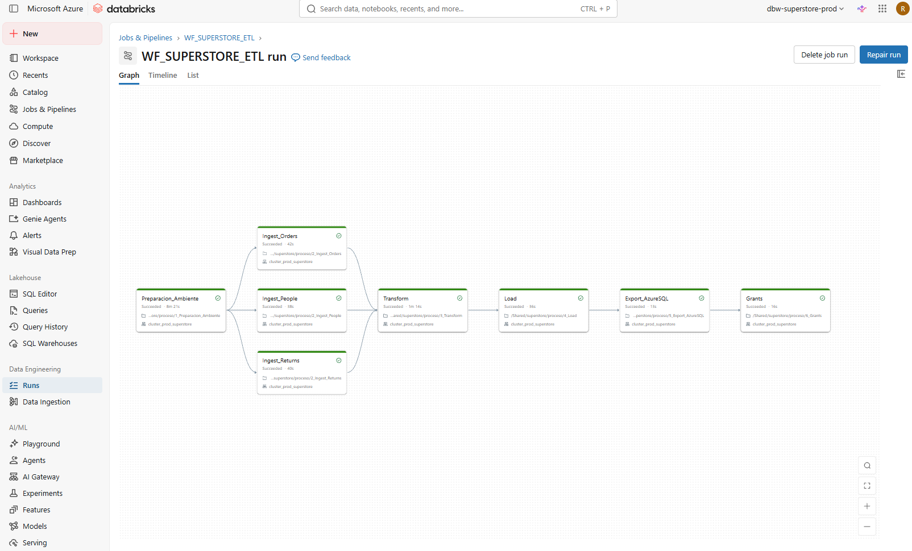

---

## 11. Visualización

| Herramienta | Fuente | Qué responde |
|---|---|---|
| **AI/BI Dashboard** (Databricks) | `superstore_prod` vía SQL Warehouse serverless | KPIs, tendencia mensual y anual, margen por región, utilidad por subcategoría, impacto del descuento y clientes ABC |
| **Genie** | 4 tablas golden + `silver.ventas_detalle` | Preguntas de negocio en lenguaje natural (ver [instrucciones](dashboard/02_genie_instrucciones.md)) |
| **Power BI** | Azure SQL Database (tablas golden exportadas por el ETL) | Reporte financiero para usuarios fuera de Databricks |

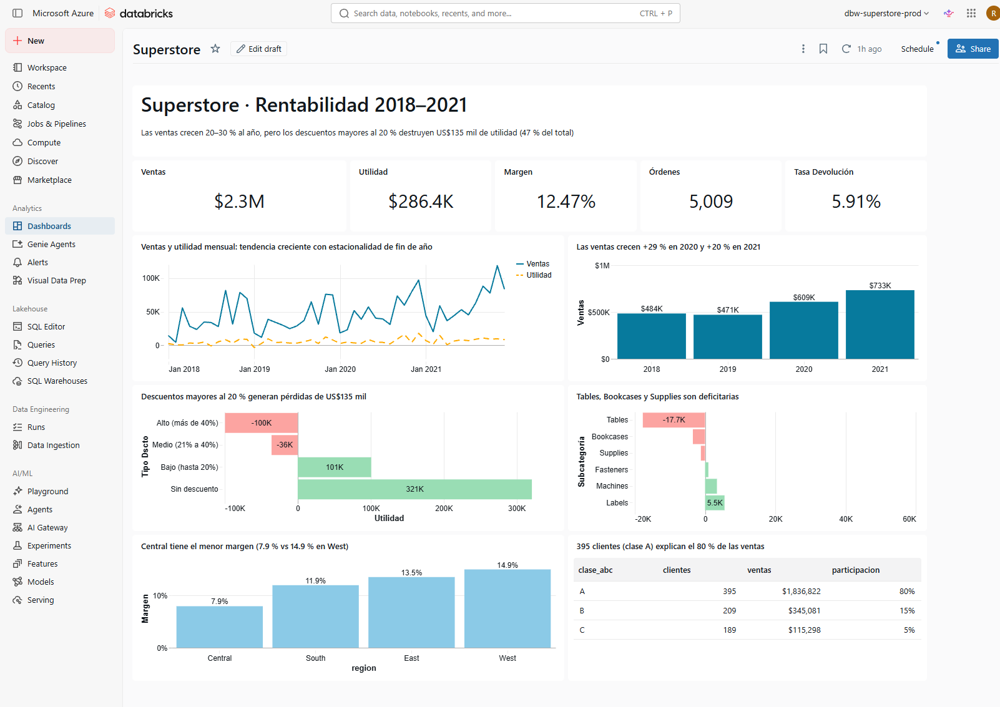

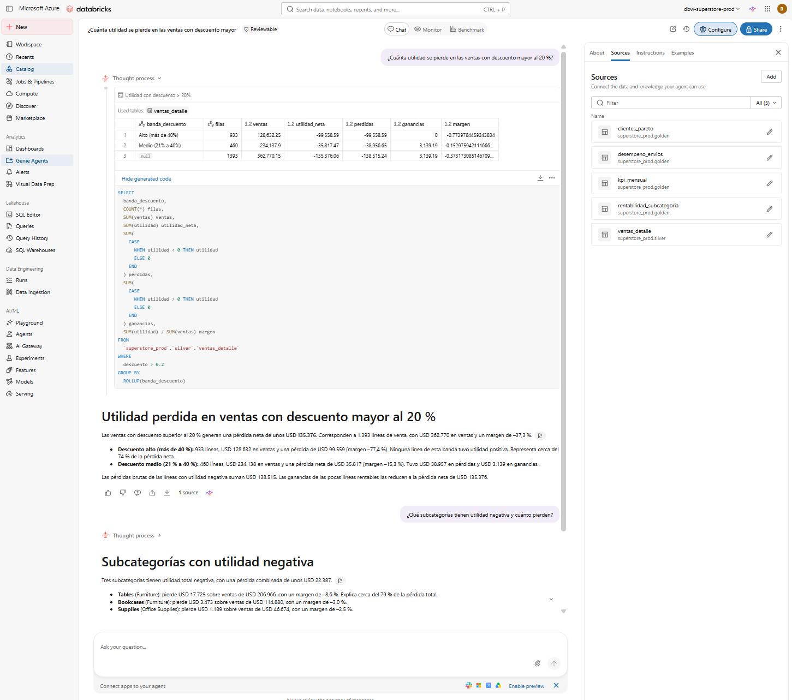

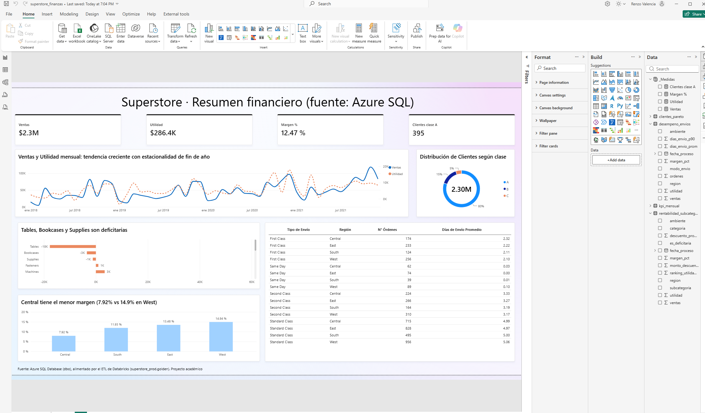

---

## 12. Delta Sharing (OpenSharing)

Share `share_superstore_golden` (tablas `kpi_mensual` y `rentabilidad_subcategoria`, con historial) para el destinatario `rcp_socio_comercial` (open sharing). Ver `delta-sharing/01_Delta_Sharing.py`.

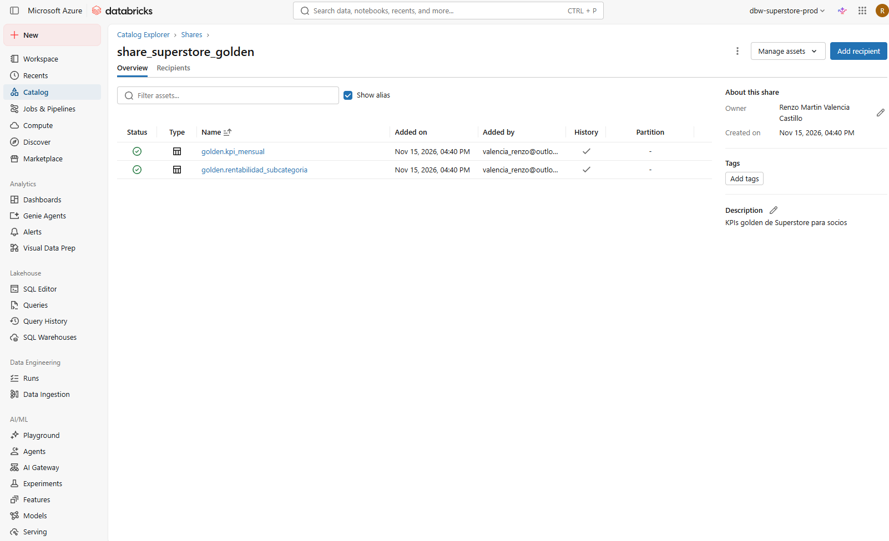

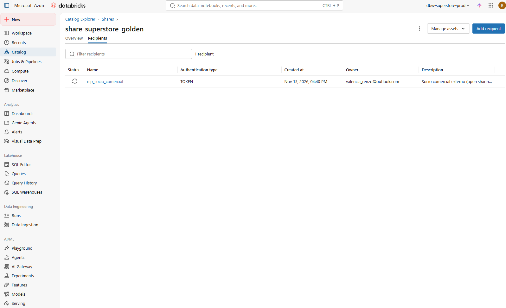

---

## 13. Reversión (plan de contingencia)

Si un pase a producción falla, se ejecuta en orden:
1. `reversion/01_Drop_Objetos_Logicos.sql`: Delta Sharing, tablas, esquemas y catálogo.
2. `reversion/02_Drop_Rutas_Fisicas.py`: directorios Delta en ADLS (con modo simulación).
3. `reversion/03_Delete_Workflow_Notebooks.py`: elimina el job y los notebooks desplegados vía API (Databricks SDK).

---

## 14. Evidencias

| # | Captura | Qué demuestra |
|---|---|---|
| 00 | [Arquitectura](evidencias/00_arquitectura.png) | Diagrama de la solución |
| 01 | [Contenedores ADLS](evidencias/01_adls_contenedores.png) | `raw`, `bronze`, `silver`, `golden`, `metastore` en ADLS Gen2 |
| 02 | [IAM del Access Connector](evidencias/02_IAM_access_connector.png) | Managed Identity con *Storage Blob Data Contributor* |
| 03 | [Resource group](evidencias/03_resource_group.png) | Servicios aprovisionados en East US 2 |
| 04 | [Storage credential](evidencias/04_storage_credential.png) | `cred_superstore_mi` (Azure Managed Identity) |
| 05 | [Usuarios y grupos](evidencias/05_usuarios_grupos.png) | 3 grupos de cuenta con sus miembros |
| 06 | [Permisos dev](evidencias/06_workspace_permissions_dev.png) · [Permisos prod](evidencias/06_workspace_permissions_prd.png) | Grupos y usuario asignados a ambos workspaces |
| 07 | [Datasets en raw](evidencias/07_raw_datasets.png) | `raw/superstore/{orders,returns,people}` |
| 08 | [Git folder en dev](evidencias/08_git_folder_dev.png) | Repo clonado en la rama `construccion` |
| 09 | [Metastore y OpenSharing](evidencias/09_metastore_opensharing.png) | Metastore compartido y Delta Sharing externo habilitado |
| 10 | [Preparación de ambiente](evidencias/10_prepamb_dev.png) | External locations, catálogo, esquemas y tablas |
| 11 | [Bronze](evidencias/11_bronze_dev.png) | 9,994 órdenes ingeridas, 0 rechazadas |
| 12 | [Silver](evidencias/12_silver_dev.png) | `ventas_detalle`, `dim_cliente`, `dim_producto` |
| 13 | [Golden + cuadre](evidencias/13_golden_dev.png) | Ventas silver = golden (US$2,297,201) |
| 14 | [Catálogo dev](evidencias/14_catalogo_dev.png) | `superstore_dev` con sus esquemas |
| 15 | [Linaje](evidencias/15_linaje.png) | Linaje automático de Unity Catalog silver → golden |
| 16 | [Auditoría](evidencias/16_auditoria.png) | `control.auditoria_etl` por ejecución |
| 17 | [Clúster prod](evidencias/17_cluster_prod.png) | `cluster_prod_superstore`: single node, Dedicated, Unity Catalog |
| 18 | [Secrets GitHub](evidencias/18_github_secrets.png) | Los 4 secrets del pipeline (solo los nombres) |
| 19 | [Pull Request](evidencias/19_pull_request.png) | Merge `construccion → main` que dispara el despliegue |
| 20 | [GitHub Actions](evidencias/20_github_actions.png) | Pipeline CI/CD en verde |
| 21 | [Notebooks en prod](evidencias/21_notebooks_prod.png) | `/Shared/superstore/proceso` desplegado |
| 22 | [Workflow prod](evidencias/22_workflow_prod.png) | `WF_SUPERSTORE_ETL`: 8 tareas en verde sobre el clúster prod |
| 23 | [Catálogo prod](evidencias/23_catalogo_prod.png) | `superstore_prod` con datos |
| 24 | [Grants prod](evidencias/24_grants_prod.png) | Permisos aplicados por la tarea `Grants` |
| 25 | [Key Vault](evidencias/25_key_vault.png) | Secretos de conexión a Azure SQL (sin valores) |
| 26 | [Azure SQL](evidencias/26_azure_sql.png) | Tablas golden exportadas a `dbo` |
| 27 | [Delta Sharing · share](evidencias/27_delta_sharing.png) | `share_superstore_golden` con 2 tablas e historial |
| 27b | [Delta Sharing · destinatario](evidencias/27b_delta_sharing_recipient.png) | `rcp_socio_comercial` (open sharing, token) pendiente de activación |
| — | [Dashboard compartido](dashboard/superstore_sharing.png) | AI/BI Dashboard compartido con `grp_consumidores_bi` (*Can View*) |

---

## 15. Certificaciones

Las 3 acreditaciones solicitadas en el curso, emitidas por Databricks Academy. Wallet público: [credentials.databricks.com/profile/renzovalencia872273/wallet](https://credentials.databricks.com/profile/renzovalencia872273/wallet)

| Acreditación (Databricks Academy) | Certificado | Verificación |
|---|---|---|
| Databricks Fundamentals | [PDF](certificaciones/01_databricks_fundamentals.pdf) | [credencial](https://credentials.databricks.com/3e61d932-b074-4303-bf42-9f5fc860a390) |
| Generative AI Fundamentals | [PDF](certificaciones/02_generative_ai_fundamentals.pdf) | [credencial](https://credentials.databricks.com/77a6cf52-dfb0-497c-ad15-d6b5ec03f86c) |
| Data Governance Fundamentals | [PDF](certificaciones/03_data_governance_fundamentals.pdf) | [credencial](https://credentials.databricks.com/bf04e033-ba18-4686-a164-6185118f4159) |

**Adicionales (Knowledge Badges):** DevOps Essentials for Data Engineering · Build Data Pipelines with Lakeflow Spark Declarative Pipelines · Data Ingestion with Lakeflow Connect · Deploy Workloads with Lakeflow Jobs.

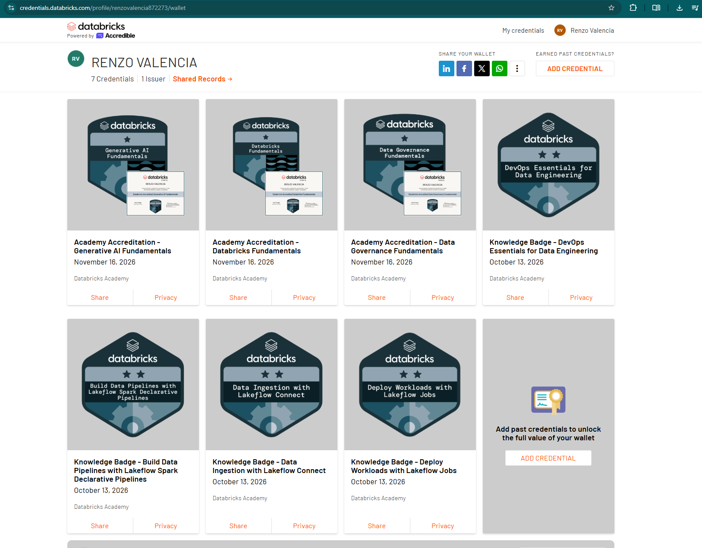

---

## 16. Cómo reproducir

1. Aprovisionar: Resource Group, ADLS Gen2 (contenedores `raw`, `bronze`, `silver`, `golden`, `metastore`), Access Connector (rol *Storage Blob Data Contributor*) y 2 workspaces Premium en la misma región.
2. Crear la Storage Credential `cred_superstore_mi` con el Resource ID del Access Connector.
3. Subir `datasets/` a `raw/superstore/{orders,returns,people}/`.
4. En dev: clonar el repo como Git folder y ejecutar `proceso/1_…` a `6_…` con `env=dev`.
5. En prod: crear el clúster `cluster_prod_superstore`, configurar los 4 secrets en GitHub y hacer merge `construccion → main`.
6. *(Opcional)* Crear Azure SQL Database + Key Vault con los secretos `sql-server`, `sql-database`, `sql-user` y `sql-password`, y el secret scope `kv-superstore` en prod. Volver a ejecutar el workflow para exportar Golden.
7. *(Opcional)* Ejecutar `delta-sharing/01_Delta_Sharing.py` en prod e importar `dashboard/superstore_ejecutivo.lvdash.json` como AI/BI Dashboard.

---
<sub>Fuente de datos: dataset Sample – Superstore (Tableau; versión pública también en Kaggle). Elaboración propia. Proyecto académico: datos ficticios, sin información confidencial.</sub>
