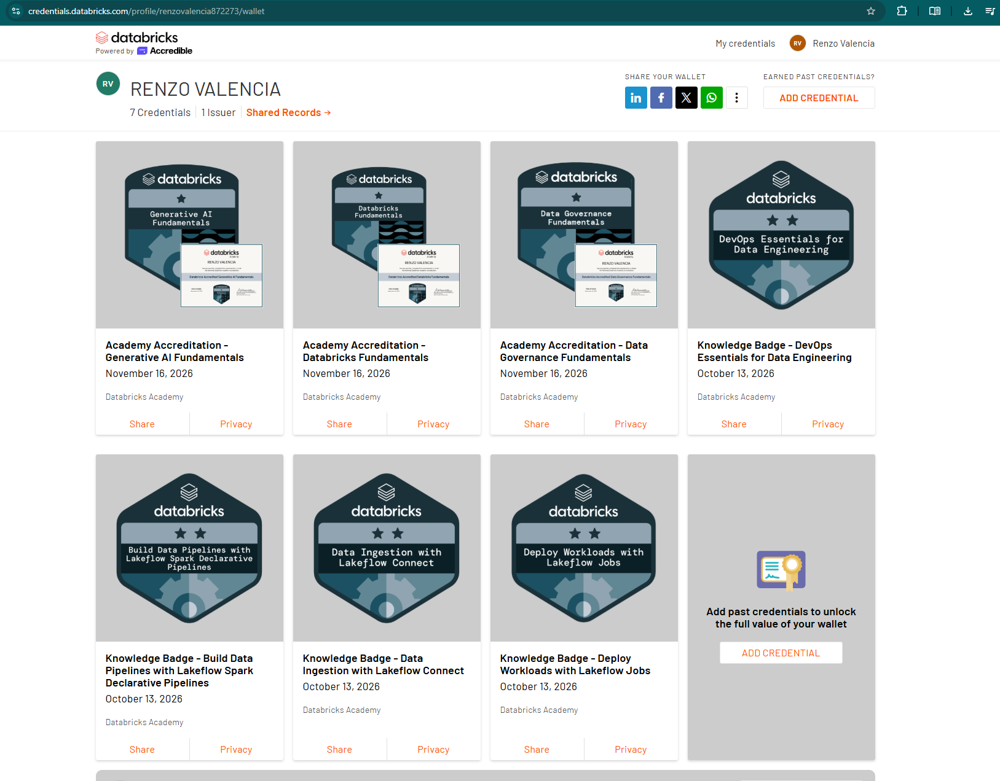

# Certificaciones · Databricks Academy

Titular: **Renzo Valencia** · Wallet público con todas las credenciales: https://credentials.databricks.com/profile/renzovalencia872273/wallet

## Acreditaciones del curso

| # | Acreditación | Emitida* | Certificado | Verificación |
|---|---|---|---|---|
| 1 | Databricks Fundamentals | 16-nov-2026 | [01_databricks_fundamentals.pdf](01_databricks_fundamentals.pdf) | https://credentials.databricks.com/3e61d932-b074-4303-bf42-9f5fc860a390 |
| 2 | Generative AI Fundamentals | 16-nov-2026 | [02_generative_ai_fundamentals.pdf](02_generative_ai_fundamentals.pdf) | https://credentials.databricks.com/77a6cf52-dfb0-497c-ad15-d6b5ec03f86c |
| 3 | Data Governance Fundamentals (reemplaza a Platform Administrator) | 16-nov-2026 | [03_data_governance_fundamentals.pdf](03_data_governance_fundamentals.pdf) | https://credentials.databricks.com/bf04e033-ba18-4686-a164-6185118f4159 |

\* Fecha en UTC según Accredible (15-nov-2026 en hora de Lima).

## Credenciales adicionales (Knowledge Badges, octubre 2026)

- DevOps Essentials for Data Engineering
- Build Data Pipelines with Lakeflow Spark Declarative Pipelines
- Data Ingestion with Lakeflow Connect
- Deploy Workloads with Lakeflow Jobs

Verificables en el wallet público.

Enlaces en texto plano: [`credenciales.txt`](credenciales.txt)
